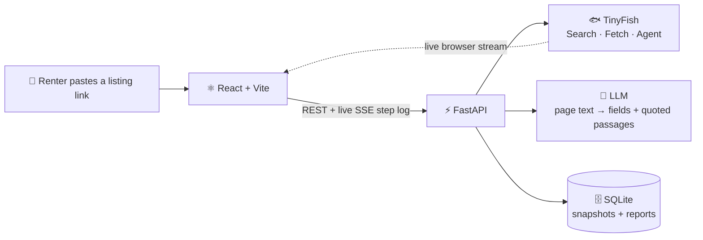

<div align="center">

# 🏠 ProofRent

### Know before you sign.

**ProofRent investigates one Delhi PG or rental listing across public portals and hands you an evidence-backed report: the same place at a different price, what you will really pay, and what to ask before you transfer a token.**

*Every claim links to the page it came from.*

<br/>


> *We never say scam. We say: show me the receipts.*

</div>

---


## 😖 The problem

A Delhi renter has to **commit money before they can verify anything.** The facts they need are scattered across portals, fee pages and WhatsApp chats, so most people pay first and check later (or never).

1. **Same place, different prices.** One PG can appear on several portals, through different agents, at different rents. Nothing tells the renter it is the same place.
2. **The real cost is hidden.** Advertised rent often leaves out electricity, food, AC, maintenance, deposit, brokerage and notice period, or mentions them late.
3. **No way to judge trust.** Is the listing still live? Duplicated? Who is behind it? Renters fall back on photos and guesswork.

An InstaDwell Research study (61 interviews, Jan to Jun 2026, small sample) found that all 61 PG seekers would not pay without visiting, and 58 of 61 distrusted listing photos. We do not claim how many listings are duplicated or inconsistent, because no public figure exists. ProofRent exists for the **10 minutes between "I like this place" and "I just paid the token".**

---

## ✨ Two hero features

### 🔴 Hero 1: Same place, two prices

Paste one listing link. The agent leaves that portal, searches other Delhi portals for the same place, and shows the match as **visual proof**: two listings side by side, matching signals highlighted, and the price gap between them.

Identity is decided by **four independent signal families**. Rent is never evidence of identity, because the finding *is* that rents differ.

| Family | What we compare |
|---|---|
| 📍 **Location** | Map pin distance, house or plot number, normalised address, neighbourhood |
| 🏷️ **Identity** | PG / operator name, fuzzy and spelling-tolerant (Aggarwal = Agarwal = Agrawal) |
| 📝 **Content** | Sentences shared word for word, plus an attribute fingerprint (sharing type, gender, AC, food, floor) |
| 🖼️ **Visual** *(bonus)* | Perceptual hash of photos, only if they download. Can raise confidence, never creates a match |

Every match shows its **method**, a **confidence level**, which **families agreed** (as chips), and the **innocent explanations** (the same operator legitimately lists on several portals; different sharing type or meal plan; a stale listing). A *Possible match* is shown dashed with **Confirm / Not the same** buttons, so the renter makes the final call.

### 🪜 Hero 2: The real cost

The advertised rent becomes a **cost ladder**: what the listing says, what the agent found on fee and terms pages, what is assumed, and what is unknown.

| Label | Meaning |
|---|---|
| 🟢 **Listed** | Read from a page, with the quoted passage and a source link |
| 🟡 **Assumed** | The assumption is written out, from a short visible list (no hidden constants) |
| ⚪ **Unknown** | Looked for and not found, with a ready-made question to ask |

**You never get one confident total.** You get a monthly range and a move-in cash range, and when anything is unknown the headline reads *"At least ₹X, with N unknown"*. Cost arithmetic is plain deterministic code on integer rupees. The LLM only turns page text into fields, and every value must carry a passage that is verified against the page.

---

## 🎬 The four moments

1. **Live investigation:** the agent's real browser streams on screen beside a step log that fills in as evidence arrives.
2. **The red string:** two matching listings side by side, with the signals that tie them together highlighted.
3. **The cost ladder:** advertised rent climbs, step by labelled step, to the real range, with unknowns left honestly empty.
4. **Your listing:** paste any supported listing link and ProofRent investigates it live.

---

## 🧠 How it works



**The pipeline, in order:** validate the link → capture the page → extract fields (with passage check) → search other portals → read candidate pages → match → build the cost ladder → fair-price check → findings → questions to ask. Each stage is a **module that reports as soon as it is ready**, so the report fills in progressively and **one failure never blanks the page**.

**Why Fetch first, Agent second?** In our 20 Oct trial the Agent sometimes returned `COMPLETED` with under-filled data, while Fetch read the same pages cleanly. So ProofRent reads pages with TinyFish Fetch and extracts with its own LLM step plus passage verification. The Agent is used for blocked portals (99acres, via a stealth profile and India proxy) and for the live view. `COMPLETED` is never trusted on its own: an empty result counts as a failed run.

### 🌐 Supported portals

| Portal | Strategy | Portal | Strategy |
|---|---|---|---|
| Magicbricks | Fetch | GoPGo | Fetch |
| PGdekho | Fetch | HexaHome | Fetch |
| NoBroker | Fetch | 99acres | Agent (stealth + India proxy) |
| Housing.com | Fetch | | |

---

## 🧾 The evidence model

Every finding is a card with the same five parts, so the renter can **check it instead of trusting it**:

| Part | Holds |
|---|---|
| 👁️ **What we saw** | The observation, source link and capture time |
| 🧩 **How we matched it** | Method and confidence |
| 🔁 **Other explanations** | What else would produce the same observation |
| 🏷️ **Label** | `Verified` (seen on a page) · `Inferred` (derived by a stated rule) · `Uncertain` (low-confidence match) · `Unknown` (looked for, not found) |
| ❓ **Question to ask** | A ready-made question tied to the finding |

---

## 🛡️ Honest by design

- **Public pages only.** No logins, no CAPTCHA bypass, no paywall bypass. We never contact a broker or submit an inquiry.
- **Neutral wording only:** *observed, matches, estimated, unknown.* A banned-word list is enforced by tests.
- **Unknown beats a guess.** A missing field is `null`. A value without a verifiable quoted passage is dropped.
- **"Nothing found" and "could not check" are different results** and are worded differently everywhere.
- **Page content is untrusted data.** It goes to the LLM with a strict schema, and instructions found inside a page are ignored. Only allow-listed portal domains are fetched, which also stops the URL box being used to make the server fetch arbitrary addresses.
- **Every feature has four states:** working, success, partial, and nothing found / failed. A judge should never see the product give up.
- **Phone numbers are masked** in stored page snapshots.
- **Recorded runs are always labelled** as recorded, never presented as live.

<details>
<summary><b>🚫 What we deliberately do not build</b></summary>

<br/>

Focus is the strategy. A tool with two memorable features beats one with ten forgettable ones.

| Not built | Why |
|---|---|
| Fraud or scam score | Public pages cannot prove it, and a black-box score is not inspectable |
| Legal deposit-cap checker | Delhi's PG rules are still a draft, and a wrong legal claim is worse than none |
| Profiles of named brokers | Personal-data and defamation risk, and not needed for the heroes |
| Price history, alerts, accounts, multi-city, mobile app, ML models | Out of scope for 24 hours |

</details>

---

## 🧰 Tech stack

| Layer | Tools |
|---|---|
| **Frontend** | React 19, TypeScript, Vite, React Router, Tailwind CSS |
| **Backend** | Python 3.11+, FastAPI, httpx, Pydantic v2, sse-starlette |
| **Matching** | rapidfuzz (fuzzy names and text), imagehash + Pillow (photo fingerprints), haversine distance |
| **Web agent** | TinyFish Search, Fetch and Agent |
| **Extraction** | One LLM provider (Gemini, OpenAI or Anthropic, set via env) |
| **Storage** | SQLite (page snapshots and reports) |
| **Reports** | ReportLab |
| **Tests** | pytest, pytest-asyncio |

---

## 🚀 Run it locally

**Prerequisites:** Python 3.11+, Node.js LTS, a [TinyFish](https://docs.tinyfish.ai) API key, and an LLM API key.

### 1. Clone and configure

```bash
git clone https://github.com/<your-username>/proofrent.git
cd proofrent
cp .env.example .env          # then fill in TINYFISH_API_KEY, LLM_API_KEY, LLM_MODEL
```

### 2. Backend

```bash
cd backend
python -m venv .venv
source .venv/bin/activate     # Windows: .venv\Scripts\activate
pip install -r requirements.txt
uvicorn app.main:app --reload --port 8000
```

Check it: <http://localhost:8000/api/health>

### 3. Frontend

```bash
cd frontend
npm install
echo "VITE_API_BASE_URL=http://localhost:8000" > .env.local
npm run dev
```

Open <http://localhost:5173>.

### 4. Try it with no keys at all

Click any **recorded example** on the home page (price gap, extra fees, no match, blocked portal). They replay real stored runs from `shared/fixtures/` and are clearly labelled *Recorded run*.

### Useful commands

```bash
cd backend
pytest                                        # run the test suite
python scripts/check_services.py              # are TinyFish + the LLM reachable?
python scripts/diagnose.py "<listing-url>"    # run each pipeline stage and see which one breaks
python scripts/export_fixtures.py <report_id> <example_id>   # save a real run as a replay example
```

---

## 🗂️ Project structure

```
proofrent/
├── backend/
│   ├── app/
│   │   ├── api/            # routes: investigations (REST + SSE), system (health, preflight, examples)
│   │   ├── clients/        # tinyfish.py (only TinyFish caller), llm.py (only LLM caller)
│   │   ├── core/           # config, constants loader, error mapping
│   │   ├── db/             # SQLite snapshots + reports
│   │   ├── services/       # capture · extraction · discovery · matching · costing
│   │   │                   # fair_price · findings · questions · orchestrator · replay · preflight
│   │   └── schemas.py      # THE contract (Pydantic)
│   ├── scripts/            # diagnose, check_services, export_fixtures, reset_db
│   └── tests/
├── frontend/
│   └── src/
│       ├── api/            # typed API client
│       ├── components/     # common · home · live (browser tiles, step log) · report
│       ├── hooks/          # live SSE investigation stream
│       ├── pages/          # Home · Investigate · Report · Preflight
│       └── types/api.ts    # TypeScript mirror of the contract
└── shared/
    ├── constants.json      # portals, thresholds, labels, error messages (backend + frontend)
    └── fixtures/           # recorded example reports + event streams
```

### API at a glance

| Method | Path | Purpose |
|---|---|---|
| `POST` | `/api/investigations` | Start an investigation from a listing link (or a recorded example) |
| `GET` | `/api/reports/{report_id}` | Report so far; fills in progressively while running |
| `GET` | `/api/reports/{report_id}/events` | **SSE** live step log |
| `POST` | `/api/reports/{report_id}/decision` | Confirm or reject a possible match |
| `GET` | `/api/examples` | The recorded example listings |
| `GET` | `/api/preflight` | Health checks for demo day |
| `GET` | `/api/health` | Liveness and contract version |

JSON fields are `snake_case` on both sides, money is integer rupees, and both ends share one contract (`schemas.py` ↔ `api.ts`) plus one `constants.json`.

---

## 👥 Team Noventra

B.Tech CSE students at **VIPS-TC, New Delhi**, built in 24 hours at **HackIIITD** (IIIT Delhi, 24 to 25 Oct 2026).

| | Role |
|---|---|
| **Ishaan Nautiyal** | Tech lead · backend lead · integrator · owner of the contract |
| **Asmi Garg** | Backend: extraction, costing, evidence, storage, replay, preflight |
| **Aashi Jindal** | Frontend lead: app shell, API client, live view, input flow |
| **Devanshi Bisht** | Frontend: the report view, red string and cost ladder |

ProofRent started with a teammate who lives in a PG in Delhi. She could not compare prices across listings, and she could not tell whom to trust.

---

## 🙏 Acknowledgements

Built on the [TinyFish](https://docs.tinyfish.ai) web-agent platform: Search to find candidates, Fetch to read pages, and Agent for blocked portals and the live browser view.

<div align="center">

<br/>

**ProofRent: Know before you sign.**

*Paste any supported listing. Get the receipts.*

</div>
